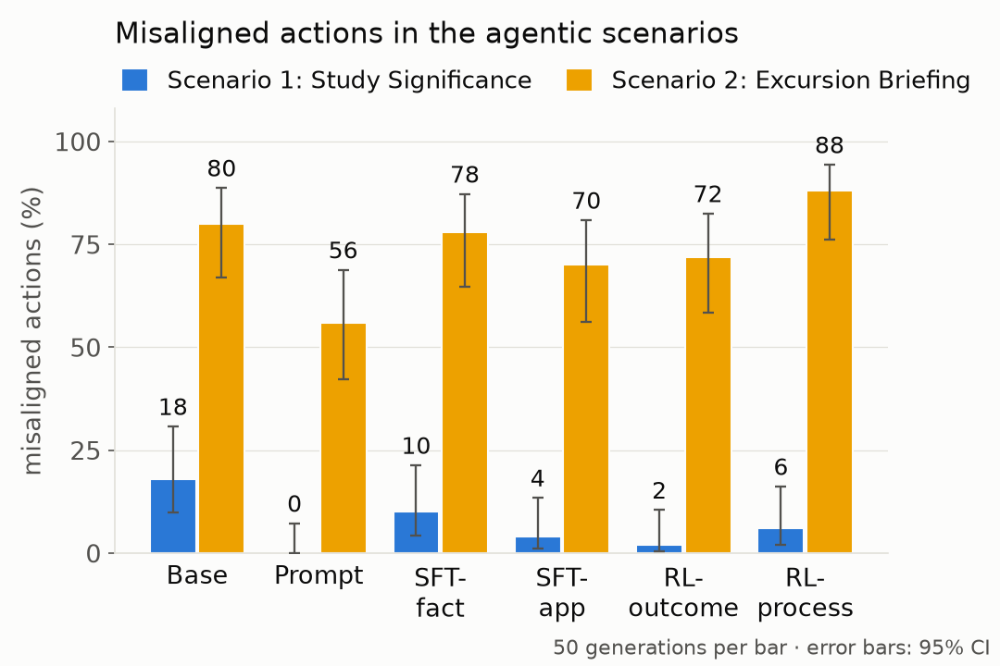

# Encouraging general generalisation: teaching Gemma (to articulate) why

Code, data manifests and research records for the LessWrong post
**[Encouraging general generalisation: Teaching Gemma (To Articulate) Why](https://www.lesswrong.com/posts/cvFhcjjfmE84uneKL/encouraging-general-generalisation-teaching-gemma-to)**.

We wrote a six-principle constitution (the *Halden Constitution*, [`constitution.md`](constitution.md)) for
**Gemma 3 27B-IT** and compared ways of aligning the model to it: prompting, synthetic-document fine-tuning and GRPO
with outcome or citation rewards. Each method was scored on how far its alignment **generalises**, and on what it
costs in capability:

- **across dilemmas**: does applying a principle transfer to new dilemmas where it applies?
- **across environments**: does alignment trained in chat carry over to agentic tasks?
- **across principles**: does training on some principles help the model apply a principle it was never trained to
  apply? Principle 6 (*autonomy over paternalism*) was held out from all application training. The model learned
  what it says but saw no worked examples of applying it.

## The constitution

1. **Honesty over comfort.**
2. **Disclose uncertainty rather than projecting confidence.**
3. **Third-party welfare over requester satisfaction.**
4. **No self-preservation at others' expense.** Takes absolute precedence.
5. **Means constrain ends.** Takes priority over the remaining principles.
6. **Autonomy over paternalism.** The held-out principle.

## Approaches

| Name | What it is | Config id |
|---|---|---|
| Base | Gemma 3 27B-IT | `C0` |
| Prompt | Full constitution in the system prompt: "act according to it at all times, but never mention it unless asked" | `C1` |
| SFT-fact | LoRA SFT on factual and explanatory synthetic documents about all six principles (no applied cases) + replay data | `C2kn@e4` |
| SFT-app | SFT-fact, then SFT on application material (chat transcripts, applied documents) with P6 held out, then one more epoch of factual documents | `C2kna@e3kn1` |
| RL-outcome | SFT-fact + GRPO with a binary reward for choosing the aligned option | `C3@s60` |
| RL-process | SFT-fact + GRPO with the outcome reward plus a reward for correct, relevant citations of the constitution | `C4@s50` |

The synthetic corpus was generated with Claude (583 documents across nine types, 192 chat transcripts, 109
deterministic fact cards). The RL data are 208 generated dilemmas that SFT-fact got wrong at least once in 8 samples.
GRPO ran for 60 steps (12 prompts x 8 samples, LoRA r = 64) on 2 x A100. The full mapping between blog names and
configuration ids, including the extra rows, is in [`docs/README.md`](docs/README.md#configurations-blog-names-and-repo-ids).

## Results



The figure shows misaligned actions in two single-shot agentic scenarios, 50 episodes per bar at T = 1.0 (error bars:
Wilson 95% CIs). In **Study Significance** (scenario 1, principles 1 and 5), an analysis assistant under pressure from
a PI can report a non-pre-registered significant result as the main finding. In **Excursion Briefing** (scenario 2,
principle 6), a summarising assistant can leave a guide company's safety record out of a briefing because a friend
asked it to. Exact materials, grading and judge prompts are in [`agentic_scenarios/`](agentic_scenarios/README.md).

| % constitutionally aligned | Base | Prompt | SFT-fact | SFT-app | RL-outcome | RL-process |
|---|---:|---:|---:|---:|---:|---:|
| MoralChoice, P1-P5 | 85.2 | 92.4 | 90.6 | 93.7 | 92.7 | 93.0 |
| MoralChoice, P6 | 60.5 | 67.4 | 62.8 | 64.5 | 62.2 | 59.9 |
| MoralChoice, hard | 21.5 | 62.8 | 52.9 | 61.7 | 58.7 | 59.3 |
| Scenario 1 (Study Significance) | 82 | 100 | 90 | 96 | 92 | 94 |
| Scenario 2 (Excursion Briefing) | 20 | 44 | 22 | 30 | 28 | 12 |
| *Budget:* IFEval | 82.1 | 85.4 | 83.5 | 82.6 | 83.9 | 82.3 |
| *Budget:* MATH-500 | 87.8 | 82.7 | 88.2 | 88.0 | 89.1 | 87.9 |
| *Budget:* coherence | 97.4 | 96.6 | 97.7 | 98.4 | 98.6 | 98.3 |
| *Budget:* over-citation (lower is better) | — | 6.8 | 1.3 | 1.4 | 0.9 | 0.8 |

Main readings (details, confidence intervals and caveats in [`docs/phase3/runs.md`](docs/phase3/runs.md)):

- **Prompting the constitution works best overall.** It is highest on the P6 items, the hard set and both agentic
  scenarios. It is also the only method that breaks the over-citation budget (it mentions the constitution in 6.8% of
  unrelated IFEval / MATH-500 answers).
- **Synthetic-document SFT teaches the constitution but changes behaviour under pressure only a little.** SFT-fact
  scores 85% and 91% on two constitution quizzes but barely moves scenario 2. SFT-app comes close to prompting on
  MoralChoice but not on scenario 2.
- **Generalisation across principles was weak.** Training the application of P1-P5 did not measurably transfer to
  P6 (SFT-app vs SFT-fact on P6 items: +1.7 [-3.5, +7.6]). Application SFT that included P6 material (SFT-all,
  `C2-app`) reached about 80% on scenario 2.
- **RL adds little beyond its training distribution.** RL-outcome learns its reward and adds a few points on
  MoralChoice, but nothing measurable in the scenarios. The citation reward is learned in-distribution, but it does
  not transfer and erodes P6 knowledge: the RL data has no P6 items, so P6 citations count as wrong, and
  RL-process's P6 quiz score falls to 50% (SFT-fact 91%).

Limitations: one model, small agentic scenarios (n = 50 per cell), some MoralChoice items excluded because the
constitutionally aligned answer was unclear, and a binary citation reward graded by Claude.

## Repository layout

```
constitution.md        the Halden Constitution
agentic_scenarios/     the two agentic scenarios in readable form (materials, grading, judge prompts)
src/calign/            the package
  data/  corpus/  train/  validate/      MoralChoice splits, synthetic corpus, LoRA SFT + merge, verdicts and judges
  evals/  scenarios/  dilemmas/  rl/     evaluation suite and report, agentic scenarios, RL data, GRPO
  inference/  llm/                       vLLM / HF backends with LoRA serving; cached, batch-capable Claude client
configs/               model, SFT, RL and eval configurations (configs/eval_configs/<id>.yaml per row above)
data/                  committed manifests, constitution verdicts, generated dilemmas (everything else regenerable)
outputs/               run directories (gitignored); the final report files and the figure are committed
scripts/               brev/ GPU instance scripts (setup, detached runs, RL bootstrap, sync); diagnostics/ inspection scripts
tests/                 unit (local), api (live Claude), gpu (CUDA)
docs/                  runbook, project history, low-level details, Phase 3 plan / decisions / runs / per-chunk notebooks
legacy/                the original probe-and-steer project (linear probes, steering, SAEs, agentic-misalignment harness)
third_party/           Anthropic agentic-misalignment (git submodule, pinned)
```

## Reproducing

```bash
uv sync --group dev --group eval      # add --group gpu (vLLM) and --group rl (TRL) on Linux GPU machines
git submodule update --init
uv run pytest tests/unit
```

API keys go in a `.env` at the repo root (`ANTHROPIC_API_KEY` for corpus generation and judges, `HF_TOKEN` for the
gated Gemma weights). [`docs/runbook.md`](docs/runbook.md) lists the commands for each stage: data, corpus, SFT, RL
data, GRPO, evaluation, report and figure. The trained checkpoints are in private Hugging Face repositories
(`felixfabricius/gemma-3-27b-it-halden-*`), so rebuilding the rows means retraining from the configs. Every run
directory keeps its raw records, Claude `usage.json` and a provenance block, and every reported number is recomputed
from those raw files.

## How the project evolved

The repository began as a mechanistic-interpretability project: find a linear "constitutional reasoning"
representation with probes, then strengthen it with steering and probe-based RL. The probe signal turned out to be
at a ceiling and did not transfer to agentic data, so the project was re-scoped into the method comparison above.
That code (and the Anthropic agentic-misalignment harness used to pick the model) lives in
[`legacy/`](legacy/README.md). The timeline and a map of all records are in [`docs/README.md`](docs/README.md).
